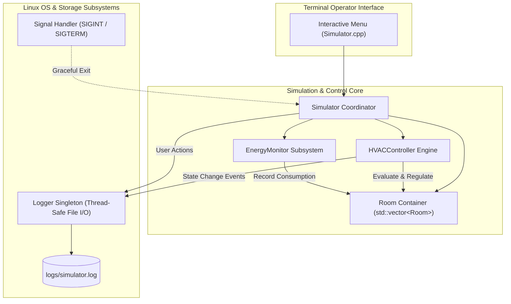
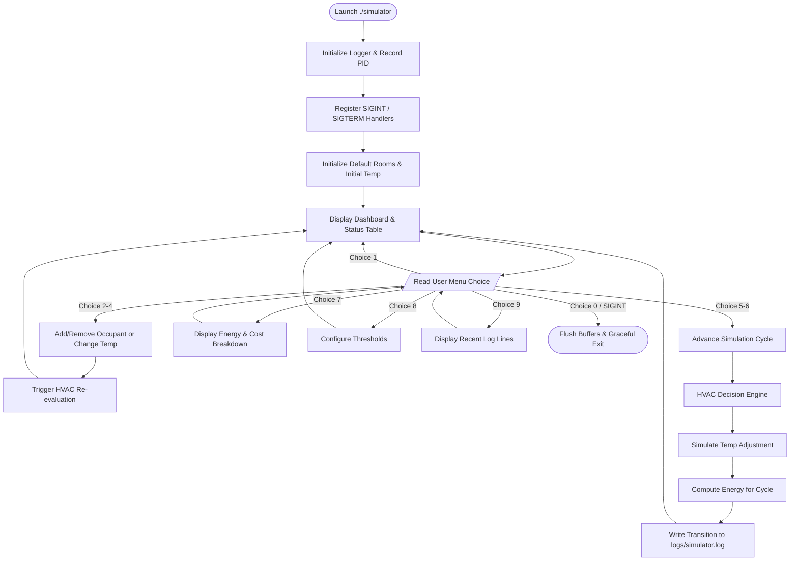

# Smart Home Occupancy & HVAC Control Simulator

> A modular, terminal-driven Linux C++ simulation system for automated climate control, occupancy tracking, and energy management in modern smart buildings.

---

## Table of Contents
1. [Introduction](#1-introduction)
2. [Problem Statement](#2-problem-statement)
3. [Objectives](#3-objectives)
4. [Features](#4-features)
5. [Technologies & Tools Used](#5-technologies--tools-used)
6. [System Requirements](#6-system-requirements)
7. [System Architecture](#7-system-architecture)
8. [Program Flow](#8-program-flow)
9. [HVAC Decision Logic](#9-hvac-decision-logic)
10. [C++ Concepts Demonstrated](#10-c-concepts-demonstrated)
11. [Linux / POSIX System Concepts](#11-linux--posix-system-concepts)
12. [Project Structure](#12-project-structure)
13. [How to Compile](#13-how-to-compile)
14. [How to Run](#14-how-to-run)
15. [Sample Terminal Output](#15-sample-terminal-output)
16. [Testing & Validation Table](#16-testing--validation-table)
17. [Limitations](#17-limitations)
18. [Future Improvements](#18-future-improvements)
19. [Interview Preparation Guide (Q&A)](#19-interview-preparation-guide-qa)
20. [Conclusion](#20-conclusion)

---

## 1. Introduction
The **Smart Home Occupancy & HVAC Control Simulator** is an object-oriented C++ software system running in a Linux/POSIX environment. It simulates an intelligent heating, ventilation, and air conditioning (HVAC) infrastructure across multiple distinct residential zones (e.g., Living Room, Master Bedroom, Kitchen, Study). The system dynamically adjusts thermal comfort based on real-time simulated occupancy and temperature data, calculates operational power consumption, and writes timestamped audit logs with process identification.

---

## 2. Problem Statement
HVAC systems account for roughly **40% to 50%** of total energy consumption in modern buildings. A substantial portion of this energy is squandered heating or cooling unoccupied rooms or maintaining excessive cooling/heating setpoints. Traditional manual thermostats fail to adapt dynamically. This project simulates an automated controller that resolves these inefficiencies by combining occupancy detection with temperature thresholds.

---

## 3. Objectives
* Model multiple independent rooms with realistic thermal and occupancy attributes.
* Formulate clear, deterministic rule-based HVAC decisions (Heating, Cooling, Idle/Comfortable, Eco-Standby).
* Calculate cumulative energy consumption ($kWh$) and financial operational costs.
* Maintain a persistent file-based audit log tagged with system timestamps and Linux Process IDs (`PID`).
* Implement POSIX signal handling for graceful program shutdowns.
* Provide an interactive, failure-tolerant terminal user interface for operator inspection and control.

---

## 4. Features
* **Zone-Based Multi-Room Management:** Monitors multiple rooms with distinct temperatures and occupancy states.
* **Intelligent HVAC State Machine:**
  * **Cooling Mode (AC On):** Activates when room is occupied and temperature exceeds the upper cooling setpoint ($> 25.0^\circ\text{C}$).
  * **Heating Mode (Heater On):** Activates when room is occupied and temperature drops below the lower heating setpoint ($< 18.0^\circ\text{C}$).
  * **Off / Idle (Comfort Zone):** Deactivates active heating/cooling when temperature is within the safe comfort band ($18.0^\circ\text{C} - 25.0^\circ\text{C}$).
  * **Eco-Standby Mode:** Automatically enters an ultra-low energy state ($20\text{ W}$) whenever occupancy drops to 0.
* **Thermodynamic Feedback Simulation:** Active AC or Heater units progressively regulate room temperatures towards the target setpoint ($22.0^\circ\text{C}$) over successive simulation cycles.
* **Energy & Financial Auditing:** Tracks power usage in Kilowatt-hours ($kWh$) per room and per subsystem, with estimated electricity tariff computations.
* **Persistent Logging Subsystem:** Append-only log file (`logs/simulator.log`) recording all state transitions, occupant arrivals/departures, and operator interventions with timestamps and PID.
* **Robust Input Validation:** Rejects negative numbers, out-of-range thermal inputs, capacity overflows, and non-numeric terminal input without crashing.

---

## 5. Technologies & Tools Used
* **Programming Language:** C++ (ISO C++17 Standard)
* **Compiler:** GNU Compiler Collection (`g++`)
* **Build System:** GNU `make` (Makefile)
* **Target Operating System:** Linux (Ubuntu/Debian, WSL 2, POSIX compliant) / MinGW on Windows
* **Version Control:** Git & GitHub

---

## 6. System Requirements
* **Operating System:** Linux (Ubuntu 20.04+ recommended), WSL 2 on Windows, or macOS.
* **Compiler:** `g++` 9.0 or higher supporting `-std=c++17`.
* **Make Utility:** GNU Make 4.1 or higher.
* **RAM & Disk:** Minimum 512 MB RAM, 15 MB free disk space.

---

## 7. System Architecture



---

## 8. Program Flow



---

## 9. HVAC Decision Logic

The core decision logic determines the HVAC operating mode using two primary environmental variables: **Occupancy Status** and **Current Ambient Temperature ($T$)**.

| Condition | Occupancy | Temperature ($T$) | HVAC Mode | Physical Action | Power Rating |
| :--- | :--- | :--- | :--- | :--- | :--- |
| **1** | $\text{Occupancy} = 0$ | Any temperature | `ECO_STANDBY` | Turn off compressor/heater; sensors idle | $0.02\text{ kW}$ |
| **2** | $\text{Occupancy} > 0$ | $T > 25.0^\circ\text{C}$ | `COOLING` | Compressor active; air blown through evaporator | $1.50\text{ kW}$ |
| **3** | $\text{Occupancy} > 0$ | $T < 18.0^\circ\text{C}$ | `HEATING` | Heating coils active; warm air circulating | $2.00\text{ kW}$ |
| **4** | $\text{Occupancy} > 0$ | $18.0^\circ\text{C} \le T \le 25.0^\circ\text{C}$ | `OFF` | Comfort target satisfied; HVAC idle | $0.00\text{ kW}$ |

---

## 10. C++ Concepts Demonstrated
1. **Object-Oriented Programming (OOP):**
   * **Encapsulation:** Private data members with validated public getters/setters in `Room`, `HVACController`, `EnergyMonitor`.
   * **Separation of Concerns:** Each class manages one single responsibility.
2. **Standard Template Library (STL):**
   * Containers: `std::vector<Room>` for dynamic collection management.
   * Algorithms & Utilities: `<iomanip>` for tabular output, `<limits>` for input stream clearing, `<chrono>` for high-resolution timing.
3. **C++17 Features:**
   * Strongly-typed scoped enums (`enum class HVACMode`).
   * `constexpr` configuration constants in dedicated namespaces.
4. **Design Patterns:**
   * **Singleton Pattern:** Used in `Logger` to guarantee a single centralized logging pipeline across all modules.
5. **Streams and File I/O:**
   * `std::ofstream` with `std::ios::app` for safe log appending and explicit `flush()`.

---

## 11. Linux / POSIX System Concepts
1. **Process Identification (`getpid()`):**
   * Reads and logs the Linux OS Process ID, demonstrating OS process lifecycle awareness.
2. **Signal Handling (`<csignal>`):**
   * Intercepts POSIX `SIGINT` (Ctrl+C) and `SIGTERM` signals via `std::signal` to ensure log buffers are cleanly flushed before the process exits.
3. **File Descriptors and Logging:**
   * Writes to standard Linux paths (`logs/simulator.log`) using file stream buffering.
4. **Compilation & Build Automation:**
   * Standard Linux `Makefile` utilizing `g++` compilation flags (`-Wall -Wextra -O2 -std=c++17`).

---

## 12. Project Structure
```text
smart_home_simulator/
├── include/
│   ├── Common.h            # Global constants, enums, and conversion functions
│   ├── EnergyMonitor.h     # Energy calculation and tariff reporting header
│   ├── HVACController.h    # Decision engine and setpoint threshold header
│   ├── Logger.h            # Thread-safe logging subsystem header
│   ├── Room.h              # Room state, occupancy, and temperature model
│   └── Simulator.h         # Master simulation controller and menu UI header
├── src/
│   ├── EnergyMonitor.cpp   # Energy accumulation implementation
│   ├── HVACController.cpp  # Rule evaluation & thermal adjustment implementation
│   ├── Logger.cpp          # Timestamped file I/O & PID logging implementation
│   ├── main.cpp            # Entry point and POSIX signal registration
│   ├── Room.cpp            # Room mutator and validation implementation
│   └── Simulator.cpp       # Coordinator and interactive dashboard implementation
├── logs/
│   ├── .gitkeep            # Preserves directory in version control
│   └── simulator.log       # Runtime output log generated upon execution
├── .gitignore              # Ignores binaries, object files, and logs
├── Makefile                # Linux build script
└── README.md               # Complete project documentation
```

---

## 13. How to Compile

### On Linux or WSL (Windows Subsystem for Linux):
```bash
# Navigate to the project root directory
cd smart_home_simulator

# Build using make
make

# Or compile manually with g++:
g++ -Wall -Wextra -std=c++17 -Iinclude -o simulator \
    src/main.cpp src/Room.cpp src/HVACController.cpp \
    src/EnergyMonitor.cpp src/Logger.cpp src/Simulator.cpp
```

### Clean Build:
```bash
make clean
```

---

## 14. How to Run
```bash
./simulator
```

---

## 15. Sample Terminal Output

```text
====================================================================
         SMART HOME OCCUPANCY & HVAC CONTROL SIMULATOR              
         Platform : Linux / POSIX C++ System Simulation             
====================================================================

================================ SMART HOME DASHBOARD ================================
 Process ID (PID)   : 14285
 Simulation Cycle   : 0 (0.00 hours simulated)
 Cooling Threshold  : > 25.0°C (Turns AC On)
 Heating Threshold  : < 18.0°C (Turns Heater On)
 Comfort Target     : 22.0°C
+-----+------------------+-----------+------------+--------------------------+-------------+
| ID  | Room Name        | Occupancy | Temp (°C)  | HVAC Mode Status         | Energy Used |
+-----+------------------+-----------+------------+--------------------------+-------------+
| 101 | Living Room      |         2 |      26.5°C | COOLING (AC On)          |   0.000 kWh |
| 102 | Master Bedroom   |         1 |      21.0°C | OFF (Comfortable)        |   0.000 kWh |
| 103 | Kitchen          |         0 |      28.0°C | ECO STANDBY (Unoccupied) |   0.000 kWh |
| 104 | Study / Office   |         1 |      17.5°C | HEATING (Heater On)      |   0.000 kWh |
+-----+------------------+-----------+------------+--------------------------+-------------+

================= OPERATOR CONTROL MENU =================
 1. View Dashboard
 2. Add Person to Room
 3. Remove Person from Room
 4. Change Room Temperature
 5. Run 1 Simulation Cycle Step (15 mins)
 6. Run Multiple Simulation Steps
 7. View Energy Consumption Report
 8. Configure HVAC Setpoints/Thresholds
 9. View Activity Log History
 0. Exit Simulator
=========================================================
Select an option [0-9]: 
```

---

## 16. Testing & Validation Table

| Test Case | Scenario / Input | Expected Result | Actual Result | Status |
| :--- | :--- | :--- | :--- | :--- |
| **TC-01** | Occupied room (Living Room) at $26.5^\circ\text{C}$ ($> 25^\circ\text{C}$) | Mode transitions to `COOLING (AC On)` | HVAC switches to `COOLING` | **PASS** |
| **TC-02** | Occupied room (Study) at $17.5^\circ\text{C}$ ($< 18^\circ\text{C}$) | Mode transitions to `HEATING (Heater On)` | HVAC switches to `HEATING` | **PASS** |
| **TC-03** | Occupied room (Bedroom) at $21.0^\circ\text{C}$ ($18 \le T \le 25$) | Mode is `OFF (Comfortable)` | HVAC remains `OFF` | **PASS** |
| **TC-04** | Empty room (Kitchen) at $28.0^\circ\text{C}$ ($0$ occupants) | Mode forced to `ECO_STANDBY (Unoccupied)` | Mode set to `ECO_STANDBY` | **PASS** |
| **TC-05** | Add occupant to empty Kitchen ($0 \to 1$) | Mode immediately re-evaluated from `ECO` to `COOLING` | Immediate switch to `COOLING` logged | **PASS** |
| **TC-06** | Remove all occupants from Living Room ($2 \to 0$) | Mode changes from `COOLING` to `ECO_STANDBY` | Immediate switch to `ECO_STANDBY` | **PASS** |
| **TC-07** | Attempt to remove more occupants than present | System rejects with error message; count unchanged | Error displayed; occupancy preserved | **PASS** |
| **TC-08** | Input temperature outside range (e.g. $150^\circ\text{C}$) | Input rejected with validation error | Bounds check prevents mutation | **PASS** |
| **TC-09** | Non-numeric input in menu (e.g. typing `"abc"`) | Stream errors cleared, prompt re-displayed | No crash or infinite loop | **PASS** |
| **TC-10** | Send `SIGINT` (Ctrl+C) via terminal | Process catches signal, writes log, exits safely | Clean shutdown with exit code | **PASS** |

---

## 17. Limitations
* **Simplified Thermal Model:** Thermal inertia, room volume, outdoor ambient heat exchange, and window insulation are modeled via constant step increments rather than partial differential heat equations.
* **Discrete Simulation Steps:** The simulation advances in discrete 15-minute intervals rather than continuous real-time clock integration.
* **Synthetic Sensor Data:** Inputs are simulated via operator command line inputs rather than physical hardware ADC/I2C sensor buses.

---

## 18. Future Improvements
1. **Multi-Threading (`std::thread` / POSIX `pthread`):** Run each room's sensor polling and HVAC controller loop as independent concurrent threads synchronized with mutexes.
2. **Inter-Process Communication (IPC):** Separate the sensor collector and the HVAC controller into two independent Linux processes communicating via POSIX shared memory or Named Pipes (`FIFO`).
3. **Hardware Sensor Integration:** Interface real physical sensors (e.g., DHT22 temperature/humidity sensor and HC-SR501 PIR motion sensor) via Raspberry Pi GPIO.
4. **Networked Socket Interface:** Introduce a lightweight Berkeley socket server (`AF_INET`, `SOCK_STREAM`) allowing remote telemetry streaming and web dashboard integration.

---

## 19. Interview Preparation Guide (Q&A)

Here are the key questions and model explanations you can use during your interview:

#### Q1: Can you explain your project in 60 seconds?
> *"I developed a Linux-based C++ simulation system called the Smart Home Occupancy & HVAC Control Simulator. In modern buildings, heating and cooling account for nearly half of all electricity costs. My program models multi-zone residential spaces and automates HVAC operation based on two key metrics: real-time occupancy and ambient temperature. When an occupied room drifts above or below configurable thresholds, the system engages air conditioning or heating. When a room is vacated, it immediately engages an eco-standby mode to conserve energy. The system records cumulative kilowatt-hours, estimates energy bills, logs audit trails with Linux Process IDs, and catches OS termination signals."*

#### Q2: Why did you choose C++ for this project?
> *"C++ is the industry standard for embedded systems, smart home automation, and building management controllers because of its deterministic performance, low memory footprint, and direct hardware-level integration capabilities. It provides strong object-oriented encapsulation while maintaining direct access to system-level POSIX APIs."*

#### Q3: Why Linux? Which Linux concepts did you utilize?
> *"Linux is the operating system powering almost all smart IoT gateways, building automation controllers, and industrial edge devices. In this project, I demonstrated key Linux system programming concepts:
> 1. Process lifecycle tracking using `getpid()` from `<unistd.h>`.
> 2. POSIX signal handling with `std::signal` to catch `SIGINT` (Ctrl+C) for graceful buffer flushes.
> 3. Linux file system handling and directory organization (`logs/simulator.log`).
> 4. GNU toolchain compilation using `g++` and modular automation with a `Makefile`."*

#### Q4: How does the HVAC decision engine work?
> *"The logic operates as a deterministic state machine:
> 1. First, it verifies occupancy: if occupancy is zero, it forces the state to `ECO_STANDBY`, preventing unnecessary heating or cooling.
> 2. If the room is occupied, it compares the temperature against setpoint thresholds. Above $25^\circ\text{C}$ triggers `COOLING`; below $18^\circ\text{C}$ triggers `HEATING`. If the temperature falls within that comfortable band, the HVAC remains `OFF`.
> 3. Any state change is automatically dispatched to the thread-safe Logger singleton to preserve an auditable event history."*

#### Q5: How is energy consumption calculated?
> *"Each simulation step models a 15-minute slice (0.25 hours). Based on the active HVAC mode, the energy monitor multiplies the subsystem's rated kilowatt power (e.g. 1.5 kW for AC, 2.0 kW for heater, 0.02 kW for eco standby) by the elapsed time to yield Kilowatt-hours ($kWh = \text{Power (kW)} \times \text{Time (hours)}$). This allows the system to generate comprehensive room-by-room and system-wide energy and cost reports."*

#### Q6: How did you ensure input validation and software stability?
> *"All terminal input functions check stream state flags (`std::cin.fail()`). If a user inputs non-numeric characters or out-of-range room IDs, the program clears the error flags with `std::cin.clear()`, discards remaining buffer characters with `std::cin.ignore()`, and prompts the user again without crashing or causing an infinite loop. Furthermore, domain constraints prevent negative occupant counts or temperatures outside physical limits."*

---

## 20. Conclusion
The **Smart Home Occupancy & HVAC Control Simulator** demonstrates a practical, robust, and clean implementation of C++ object-oriented design and Linux systems programming. It directly addresses the real-world problem of building energy efficiency through clear automation logic, strict error handling, and structured documentation.
